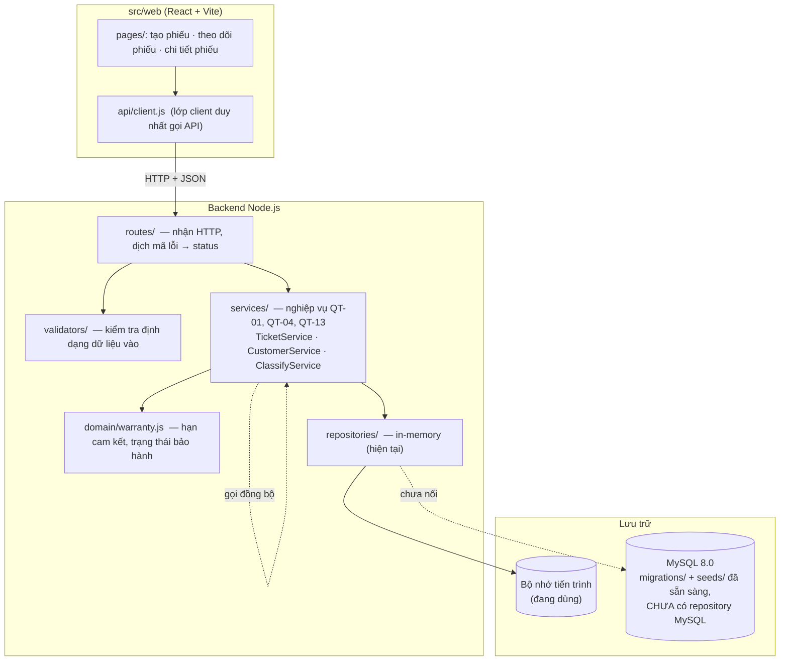

# Kiến trúc THỰC TẾ (BT2) — luồng L2 Tiếp nhận và phân loại yêu cầu bảo hành

Sơ đồ dưới đây mô tả những gì **đang chạy**, khác với sơ đồ dự kiến `architecture.drawio` (BT1).
Khác biệt chính: tầng lưu trữ hiện là bộ nhớ, MySQL mới có migration + seed (xem `thay-doi-thiet-ke.md`).

## Vị trí từng tầng trong repo

| Tầng | Thư mục | Quy tắc |
|---|---|---|
| Trình bày | `src/web/` | Chỉ gọi API qua `src/web/api/`; có ba trạng thái đang tải / rỗng / lỗi |
| Routes | `src/routes/` | Biết HTTP; không chứa nghiệp vụ |
| Validators | `src/validators/` | Kiểm tra định dạng/kiểu, chạy trước service |
| Services | `src/services/` | Nghiệp vụ; không có `req`, `res`, mã HTTP, SQL |
| Repositories | `src/repositories/` | Chỉ đọc/ghi dữ liệu; không chứa quy tắc nghiệp vụ |
| Lưu trữ | `migrations/`, `seeds/` | Dựng CSDL từ trạng thái trống và nạp dữ liệu mẫu |

Phụ thuộc một chiều: `routes → services → repositories`.

## Ngoài phạm vi (WON'T)
- Gửi SMS tự động cho khách hàng (US8).
- Thuật toán gán kỹ thuật viên tự động (luồng L4).
