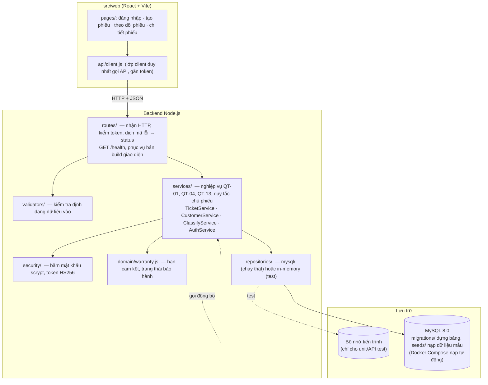

# Kiến trúc THỰC TẾ — luồng L2 Tiếp nhận và phân loại yêu cầu bảo hành

Sơ đồ dưới đây mô tả những gì **đang chạy** ở tag `v1.0` (cập nhật ở Bài tập 3), khác với sơ đồ dự kiến `architecture.drawio` (BT1).
Khác biệt chính: có repository MySQL thật cho `npm start` và Docker (repository bộ nhớ chỉ còn dùng cho unit/API test),
có đăng nhập và quy tắc chủ phiếu, và máy chủ Node phục vụ luôn giao diện và `GET /health` (xem `thay-doi-thiet-ke.md`).

## Vị trí từng tầng trong repo

| Tầng | Thư mục | Quy tắc |
|---|---|---|
| Trình bày | `src/web/` | Chỉ gọi API qua `src/web/api/`; có ba trạng thái đang tải / rỗng / lỗi |
| Routes | `src/routes/` | Biết HTTP; không chứa nghiệp vụ; mặc định mọi route cần token, chỉ đăng nhập là `public` |
| Validators | `src/validators/` | Kiểm tra định dạng/kiểu, chạy trước service |
| Services | `src/services/` | Nghiệp vụ; không có `req`, `res`, mã HTTP, SQL |
| Security | `src/security/` | Băm mật khẩu (scrypt) và token HS256 bằng `node:crypto` |
| Repositories | `src/repositories/` | Chỉ đọc/ghi dữ liệu; không chứa quy tắc nghiệp vụ; `mysql/` cho chạy thật, `in-memory.js` cho test |
| Lưu trữ | `migrations/`, `seeds/` | Dựng CSDL từ trạng thái trống và nạp dữ liệu mẫu |

Phụ thuộc một chiều: `routes → services → repositories`.

## Ngoài phạm vi (WON'T)
- Gửi SMS tự động cho khách hàng (US8).
- Thuật toán gán kỹ thuật viên tự động (luồng L4).
